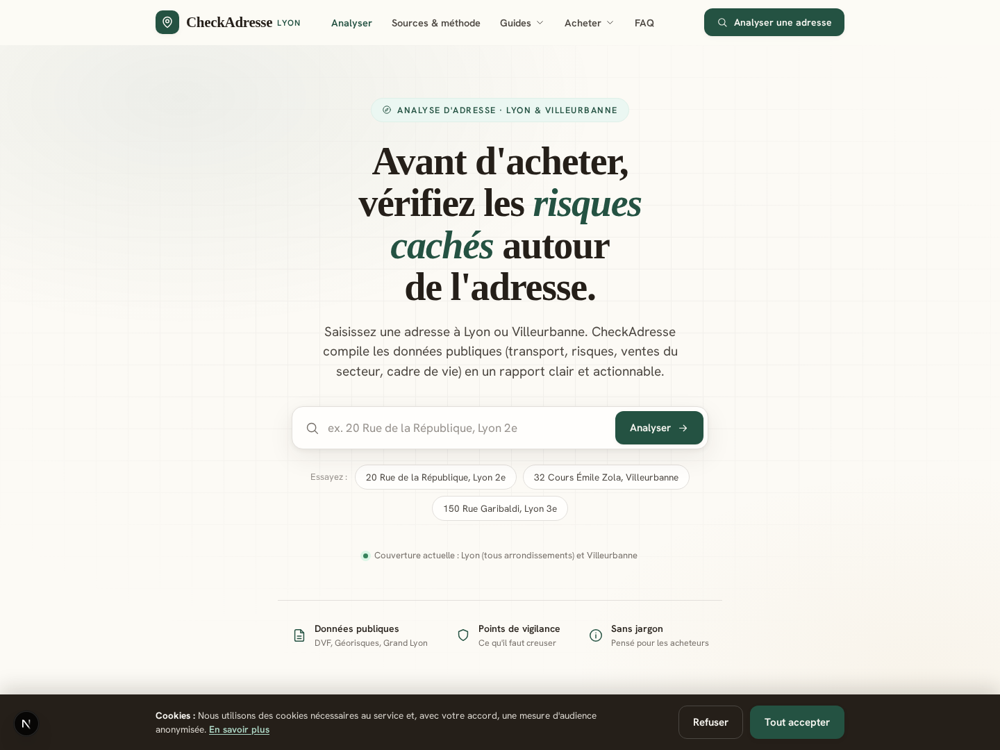
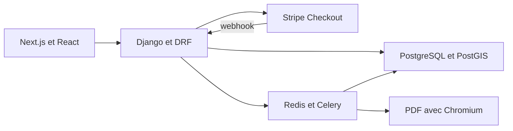
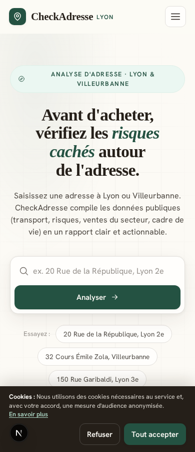

# CheckAdresse Lyon

**Un produit web pour comprendre le contexte d'une adresse à Lyon ou Villeurbanne
avant un achat immobilier.** Cette vitrine présente l'architecture et l'interface
d'un projet full stack dont le dépôt de travail reste privé.

## Le besoin

Rassembler des informations dispersées sur les transactions immobilières, les
transports, les risques et le cadre de vie, en conservant leurs sources et leurs
limites. Le produit prévoit un aperçu gratuit et un rapport complet accessible
après paiement.

## Travail réalisé

Le projet réunit une interface React avec Next.js, une API Django, des données
géographiques dans PostGIS et des traitements asynchrones. L'implémentation
comprend la recherche d'adresse, la construction de rapports, le parcours de
paiement Stripe et le rendu PDF côté serveur.

Une attention particulière porte sur la cohérence du parcours : le paiement est
conditionné par l'état des données, le webhook déclenche le traitement asynchrone
et la consultation d'un rapport utilise une session dédiée. La documentation et
les contrats rendent visibles les données manquantes et les limites des scores.

## Architecture

| Partie | Choix technique |
| --- | --- |
| Interface | Next.js, React, TypeScript et Leaflet |
| API et données géographiques | Django, Django REST Framework et GeoDjango |
| Stockage | PostgreSQL avec PostGIS |
| Traitements différés | Celery avec Redis |
| Paiement | Stripe Checkout et webhook |
| Parcours et PDF | Playwright et Chromium |

## Interface sur mobile

Les captures proviennent de l'accueil local du frontend, sans saisie d'adresse
ni soumission de formulaire. Elles montrent l'interface ; elles ne constituent
pas une validation du paiement, d'un rapport ou d'un service en production.

## État et limites

Le code implémente le parcours décrit. Cette publication documentaire n'établit
pas son exploitation en production et ne distribue ni backend, ni données,
ni configuration opérationnelle. Un rapport immobilier exige des sources à jour
et leurs contrôles de disponibilité.

CheckAdresse Lyon est un service indépendant. Ses scores ne constituent pas une
estimation immobilière garantie, un conseil juridique ou une preuve d'absence
de risque. Les données absentes doivent rester explicites dans le rapport.

La [provenance des visuels et de la présentation](PROVENANCE.md) indique l'état
source utilisé. [Baptiste Ageron](https://github.com/BaptisteAg), développeur full
stack chez IDEAGENCY.
